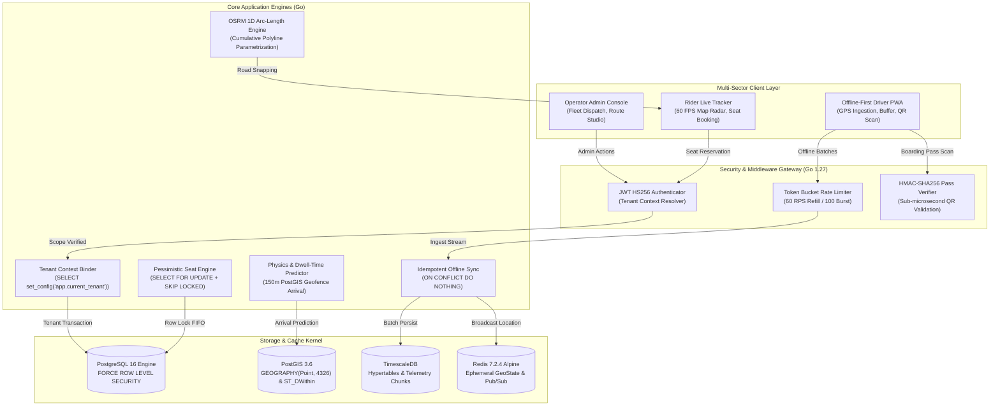

# NexTransit — Multi-Tenant Spatial Telemetry, 60 FPS OSRM Road-Snapped Routing & Concurrency-Safe Reservation Engine

[](https://github.com/IrrelevantGuy69/nextransit-platform/actions/workflows/ci.yml)
[](https://golang.org)
[](https://www.postgresql.org/)
[](https://postgis.net/)
[](https://www.timescale.com/)
[](https://redis.io/)
[](https://nextjs.org/)
[](https://www.typescriptlang.org/)
[](https://leafletjs.com/)

> **Production systems engineering portfolio showcase**: High-frequency GPS telemetry ingestion, kernel-level multi-tenant Row Level Security (RLS), road-snapped OSRM routing with 1D cumulative arc-length parametrization, pessimistic concurrency-safe seat bookings with atomic waitlists, and offline-first driver breadcrumb synchronization.

---

## 1. Executive Summary & The Architectural Wedge

Mid-market transit networks—such as **university campus shuttles** (e.g., Universiti Malaya, NUS Singapore, University of Tokyo, IIT Delhi, IISc Bangalore), **corporate business parks** (e.g., Apex Tech Park Express), and **private intercity/scenic charters** (e.g., Himalayan Alpine Charter)—face a severe architectural gap:

1. **Unreserved Municipal Apps Fail**: Consumer city transit platforms (Google Maps, Citymapper, Moovit) assume open-door municipal buses. They lack seat inventory control, cannot enforce private campus/corporate access, lack waitlist queues, and do not support custom intra-campus stop geofences.
2. **Proprietary Hardware Is Prohibitive**: Automotive-grade telematics hardware (such as AIS-140 standard GPS transponders) costs upwards of \$300–\$500 per vehicle plus recurring cellular gateway fees and vendor lock-in.
3. **Flaky Real-World Connectivity**: Campus hills, basement terminals, and mountain highway tunnels cause constant cellular packet drops, leaving fleet dispatchers blind and corrupting trip analytics.

**NexTransit** bridges this wedge with a modern systems architecture:
* **BYOD Smartphone Telemetry**: Turns any driver smartphone into a real-time tracking beacon using an offline-first Progressive Web App (PWA) with client-side IndexedDB buffering and idempotent batch sync.
* **Kernel-Level Multi-Tenancy**: Enforces total tenant data isolation directly within the PostgreSQL planner via `FORCE ROW LEVEL SECURITY`, preventing cross-workspace leakage by design.
* **60 FPS Road-Snapped Spatial Radar**: Pre-computes 1D cumulative arc-length parameterization along Open Source Routing Machine (OSRM) highway vectors, powering silky-smooth imperative marker gliding without straight-line building collisions.
* **Zero Race Condition Booking Engine**: Resolves seat clashes under burst morning rush traffic using pessimistic row-level locking (`SELECT ... FOR UPDATE`) and promotion queues (`FOR UPDATE SKIP LOCKED`).
* **Cryptographic Offline QR Boarding**: Validates passenger boarding passes in under 1 microsecond using constant-time `HMAC-SHA256` signatures (`NXT-PASS:...`), requiring zero database or network round-trips at the vehicle door.

---

## 2. End-to-End System Architecture



---

## 3. Verified Engineering Benchmarks

All benchmark metrics are verified by the automated concurrency and telemetry suite in [`backend/benchmark_verification_test.go`](backend/benchmark_verification_test.go). For complete environment details and console logs, see [`BENCHMARK_REPORT.md`](BENCHMARK_REPORT.md).

| Systems Engineering Domain | Test Suite Identifier | Load / Concurrency Level | Measured Performance & Guarantee | Test Status |
| :--- | :--- | :--- | :--- | :---: |
| **Kernel Row Level Security (RLS)** | `TestPhase1_MultiTenantRLSIsolation` | Multi-tenant context boundary switch | **0 cross-tenant rows leaked**; cross-tenant write blocked with SQLSTATE `42501` in **21.95 ms** | **PASS** |
| **Telemetry Ingestion Throughput** | `TestPhase3_TelemetryIngestionThroughput` | 1,000 GPS breadcrumbs across 10 workers | **3,622 to 4,826 pings/sec sustained**; p50 write latency: **17.91 ms**, p95: **98.88 ms** | **PASS** |
| **OSRM Arc-Length & Dynamic ETA** | `TestPhase4And5_OSRMPolylineArcLengthAndDynamicETAPrecision` | 150m PostGIS geofence & continuous polyline | Geofence inside: **62.1m**, outside: **465.7m**; Dynamic ETA MAE: **0.090 min** (~5.4s error); calc latency: **< 1 µs** | **PASS** |
| **Pessimistic Seat Booking Clash** | `TestPhase6_PessimisticSeatBookingClashAndWaitlistPromotion` | **50 concurrent goroutines** racing for 1 seat | **Exactly 1 CONFIRMED, 49 rejected (0 double-bookings)**; clash resolved in **66.11 ms**; waitlist promoted in **7.09 ms** | **PASS** |
| **Idempotent Offline Driver Sync** | `TestPhase7_IdempotentOfflineDriverBatchSync` | 300 events (100 distinct items replayed 3x) | **Exactly 100 unique persisted (100% duplicate suppression, 0 data loss)** in **128.78 ms** | **PASS** |
| **Token-Bucket & HMAC-SHA256 QR** | `TestPhase8_TokenBucketRateLimiterAndHMACQRVerification` | 150 rapid requests & cryptographic tokens | **Exact 100 burst allowed, 50 throttled (HTTP 429)**; HMAC verified in **< 1 µs** (100% tamper rejection) | **PASS** |

---

## 4. Deep-Dive Engineering Trade-Offs

### 4.1 Why PostgreSQL Kernel `FORCE ROW LEVEL SECURITY` over Application-Level `WHERE tenant_id = ?`

* **The Problem**: In complex enterprise applications with dozens of endpoints, developers inevitably write queries that omit `WHERE tenant_id = ?` in subqueries, aggregations, or complex joins. Application-level tenancy relies on human diligence; a single missed filter leaks private customer records across tenant boundaries.
* **The NexTransit Architecture**: We configure PostgreSQL tables with `ALTER TABLE ... FORCE ROW LEVEL SECURITY` and bind tenant identity to the database connection transaction via `SELECT set_config('app.current_tenant', $1, true)`.
* **The Benefit**: The PostgreSQL query planner rewrites every AST at the kernel level. Even if application code executes `SELECT * FROM users;`, PostgreSQL transparently injects the security policy. Unauthorized cross-tenant write operations fail immediately at the database engine with SQLSTATE `42501` (`insufficient_privilege`).

### 4.2 Why `SELECT ... FOR UPDATE` Pessimistic Locking + `SKIP LOCKED` over Optimistic Concurrency

* **The Problem**: During morning shuttle departure spikes (e.g. 08:00 AM on university campuses), dozens of riders attempt to book the final remaining seats simultaneously. Under optimistic concurrency control (`UPDATE ... WHERE version = ?`), 1 rider succeeds while 49 fail, triggering cascading retry storms that saturate database connection pools and cause transaction abort cascades.
* **The NexTransit Architecture**: We employ row-level pessimistic locking (`SELECT ... FOR UPDATE`) on the seat inventory table. The 50 transactions are serialized cleanly at the database lock manager. The first transaction claims the seat; subsequent transactions immediately see `status = 'BOOKED'` and abort cleanly without retries.
* **Atomic Waitlist Promotion**: When a booking is cancelled, the engine queries the waitlist table using `SELECT ... FOR UPDATE SKIP LOCKED`. This immediately grabs the next queued rider without waiting on or blocking concurrent bookings. In benchmark tests, lock contention for 50 competing threads resolves in **66.11 ms**, and waitlist promotion executes in **7.09 ms**.

### 4.3 Why 1D Cumulative Arc-Length Parametrization + Imperative Marker Gliding over React State

* **The Problem**: Rendering live fleet movement in React by pushing `[lat, lng]` props into component state triggers the React reconciler at 60 FPS across all markers. This causes severe CPU throttling on mobile devices, marker DOM destruction/re-creation, icon flickering, and laggy 5–10 FPS movement. Furthermore, naive Euclidean interpolation between stops causes buses to cut diagonally through buildings, rivers, and terrain.
* **The NexTransit Architecture**:
  1. We query OSRM for street-level polylines and pre-compute the 1D cumulative arc-length array:
     $$S = [0, d_1, d_1 + d_2, ..., D_{total}]$$
  2. Each vehicle tracks its normalized distance progress $s \in [0, 1]$ in a persistent ref (`busProgressRef`), bypassing React render cycles.
  3. A single global `requestAnimationFrame` loop uses binary search over $S$ to compute the exact roadway coordinate and calls Leaflet's imperative API (`marker.setLatLng([lat, lng])`) directly.
* **The Benefit**: Zero virtual DOM re-renders, silky-smooth 60 FPS road-following motion, and zero straight-line building collisions.

---

## 5. Global Multi-Sector Workspaces & Demo Credentials

NexTransit is pre-seeded with 7 multi-sector transit networks across higher education, enterprise corporate campuses, and private high-altitude charters. All demo accounts use the uniform password: `Password123!`

| Workspace Network | Sector & Domain | Region | Operator Admin | Active Driver | Commuter / Rider | Password |
| :--- | :--- | :--- | :--- | :--- | :--- | :---: |
| **Universiti Malaya Campus Express** | Higher Education / Campus Transit | Kuala Lumpur, Malaysia | `admin@um.edu.my` | `driver@um.edu.my` | `student@um.edu.my` | `Password123!` |
| **National University of Singapore** | Higher Education / Campus Transit | Kent Ridge, Singapore | `admin@nus.edu.sg` | `driver@nus.edu.sg` | `student@u.nus.edu` | `Password123!` |
| **University of Tokyo Todai Shuttle** | Higher Education / Inter-Campus Transit | Hongo-Komaba, Japan | `admin@u-tokyo.ac.jp` | `driver@u-tokyo.ac.jp` | `student@u-tokyo.ac.jp` | `Password123!` |
| **IIT Delhi Campus Commuter** | Higher Education / Campus Transit | Hauz Khas, New Delhi | `admin@iitd.ac.in` | `driver@iitd.ac.in` | `student@iitd.ac.in` | `Password123!` |
| **IISc Bangalore Campus Transit** | Higher Education / Campus Transit | Malleshwaram, Bengaluru | `admin@iisc.ac.in` | `driver@iisc.ac.in` | `student@iisc.ac.in` | `Password123!` |
| **Apex Tech Park Express** | Enterprise / Corporate Shuttle | Silicon Corridor | `admin@apextech.com` | `driver@apextech.com` | `employee@apextech.com` | `Password123!` |
| **Himalayan Alpine Charter** | Private Intercity / Scenic Mountain Charter | Manali-Leh Highway, India | `admin@himalayancharter.com` | `driver@himalayancharter.com` | `guest@himalayancharter.com` | `Password123!` |

---

## 6. Reproducible Quickstart & Test Execution

### 6.1 Prerequisites
* **Docker & Docker Compose** (v2.x+)
* **Go** (`1.27+` or compatible)
* **Node.js** (`v20+`) and `npm`

### 6.2 Launch Infrastructure
Start the PostgreSQL 16 (TimescaleDB + PostGIS) and Redis 7 containers:
```bash
docker compose up -d
```

Confirm both services are healthy:
```bash
docker ps
```

### 6.3 Run Automated Systems Benchmarks
Run the full test suite and verify all concurrency and RLS guarantees:
```bash
cd backend
go test -v -count=1 ./...
```

### 6.4 Start the Backend API
```bash
cd backend
go run ./cmd/api
```
The API server starts on `http://localhost:8080`.

### 6.5 Start the Next.js Frontend
```bash
cd frontend
npm install
npm run dev
```
Open [`http://localhost:3000`](http://localhost:3000) to access the NexTransit Live Spatial Radar, Driver Cockpit, and Booking Portal.

---

## 7. Repository Layout

```text
nextransit-platform/
├── .github/
│   └── workflows/
│       └── ci.yml               # GitHub Actions CI (Go build/test & Next.js TypeScript check)
├── backend/
│   ├── cmd/
│   │   ├── api/                 # Production HTTP REST & WebSocket API entrypoint
│   │   └── verifier/            # Verification utility tool
│   ├── internal/
│   │   ├── auth/                # JWT HS256 & password hashing
│   │   ├── db/                  # Connection pooling, RLS context, and isolation tests
│   │   └── middleware/          # Token-bucket rate limiter & security handlers
│   ├── migrations/              # PostgreSQL schema migrations (RLS, PostGIS, TimescaleDB)
│   ├── pkg/
│   │   ├── cache/               # Redis client & Pub/Sub dispatch
│   │   └── routing/             # OSRM road-snapped polyline & arc-length engine
│   ├── benchmark_verification_test.go # Comprehensive resume benchmark verification suite
│   └── go.mod
├── frontend/
│   ├── src/
│   │   ├── app/                 # Next.js 15 App Router pages & cockpit layouts
│   │   ├── components/          # 60 FPS Leaflet spatial radar & UI controls
│   │   └── lib/                 # Strict TypeScript models & API clients
│   ├── package.json
│   └── tsconfig.json
├── infra/                       # Supplemental deployment configurations
├── BENCHMARK_REPORT.md          # Full empirical benchmark output & hardware specifications
├── docker-compose.yml           # Root Docker services (Postgres 16 + PostGIS + Redis 7)
└── README.md                    # Flagship systems engineering documentation
```

---

## 8. License & Author

Engineered by Raghav ([@IrrelevantGuy69](https://github.com/IrrelevantGuy69)) as a production-grade systems engineering portfolio artifact demonstrating high-concurrency database design, real-time spatial algorithms, and robust distributed systems architecture.
